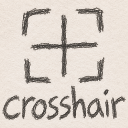

# All-crosshair — Fabric 1.21.11

An original client-side implementation of three crosshair features:
- Four disconnected corner marks around your crosshair when your targeted player is within attack reach.
- Physical framebuffer centering for the vanilla crosshair, including odd window sizes and GUI scaling.
- Crosshair visibility in rear/front third-person (F5), controlled independently.

The normal crosshair texture and attack cooldown indicator remain rendered by Minecraft.
Resource-pack crosshair textures remain supported. Other crosshair-rendering mods can conflict.

## Install
1. Use Minecraft **1.21.11** with Fabric Loader **0.18.4 or later**, Java 21, and Fabric API for 1.21.11.
2. Download **all-crosshair-1.1.0.jar** from [Releases](https://github.com/EnvityXD/All-crosshair/releases/latest) and put it in your instance's mods folder.
3. Remove/disable Crosshair Indicator, Centered Crosshair, and F5 Crosshair to avoid overlapping changes.
4. Open **Mods → All-crosshair → Configure** with Mod Menu 17.x installed, or press **Right Shift** in-game. Mod Menu is optional.
5. Remove the previous ENVITY Crosshair JAR when upgrading. Settings from `config/envity-crosshair.json` automatically copy to `config/all-crosshair.json` on first launch.
Do not install this client-only mod on a dedicated server.

## Settings
Separate toggles: master enable, indicator, centering, F5 rear, F5 front, and players-only targeting.
The indicator defaults to the vanilla inverted-color style, matching the four-corner reference.
Click its color button to cycle white (vanilla inversion), green, red, cyan and yellow; a swatch shows the selection.
When upgrading from 1.0.0, the old green default migrates to white; other colors and feature toggles are retained.
Click indicator size to cycle 4–16 GUI pixels.
Controls → Key Binds allows remapping the settings shortcut and assigning a master toggle (unbound by default).
Settings persist immediately in config/all-crosshair.json. With Minecraft closed, advanced users may edit
color (signed decimal ARGB) and radius in that file.

The indicator uses vanilla targeting and the player's current entity interaction range, checks line of sight,
and does not wait for a full attack cooldown. It does not extend reach or attack automatically.
It is a client-side estimate, not a guarantee the server will accept a hit.
In third person it only indicates a vanilla crosshair target also within reach of the player's eye.
Front-view crosshairs are visual aids and do not change the player's attack direction.

## Build
Use JDK 21:
- Windows: gradlew.bat build
- Linux/macOS: ./gradlew build
Output: build/libs/all-crosshair-1.1.0.jar
Pinned dependencies are in build.gradle.

## Verification
Built against the exact 1.21.11 Yarn mappings and Fabric API.
Build, Mod Menu API integration compilation and configuration migration/persistence checks passed.
Live Minecraft visual/gameplay validation has not been performed in this workspace.
Recommended checks:
- Toggle each feature independently and verify settings survive a restart.
- Aim at a player just inside/outside normal reach and behind a solid wall.
- Confirm the indicator works while the attack cooldown is recharging.
- Switch first person / rear F5 / front F5, including while aiming at yourself.
- Check several GUI scales, odd/even window sizes, F1, debug view, and spectator mode.
- Confirm vanilla/resource-pack crosshair and cooldown rendering, and no overlays in menus.
- Check alongside Sodium and your usual HUD mods.

## References
Feature inspirations, not bundled dependencies or copied mod code:
https://modrinth.com/mod/crosshair-indicator
https://modrinth.com/project/xUTHly0N
https://modrinth.com/project/EsJaRa1U

Author: ENVITY

## File guide

GitHub's file listing shows the latest **commit message**, not a per-file description.
The complete file-by-file guide is in [docs/FILES.md](docs/FILES.md).

| Area | Purpose |
| --- | --- |
| `src/main/java/dev/envity/allcrosshair` | Client setup, saved configuration and in-game settings screen |
| `src/main/java/dev/envity/allcrosshair/mixin` | Hooks into the vanilla HUD for F5, centering and reach display |
| `src/main/resources` | Mod metadata, mixin registration, translations and corner sprite |
| `gradle/wrapper` | Pinned Gradle launcher for reproducible builds |
| `docs` | File reference and release history |

## Releases

**1.1.0** rebrands the mod to All-crosshair, adds a sketch logo and proper Mod Menu configuration integration.

**1.0.1** fixes the indicator's appearance: four separate corner marks replace the old side brackets.
White uses the vanilla crosshair blending pipeline; optional colored indicators remain configurable.
See [CHANGELOG.md](CHANGELOG.md) for changes and installation details.
